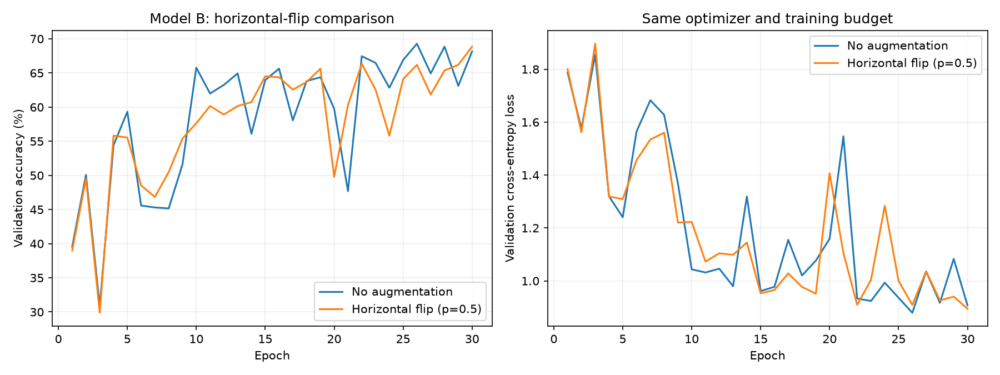
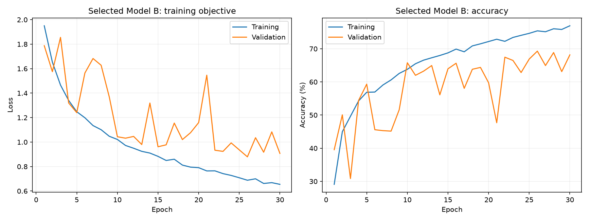
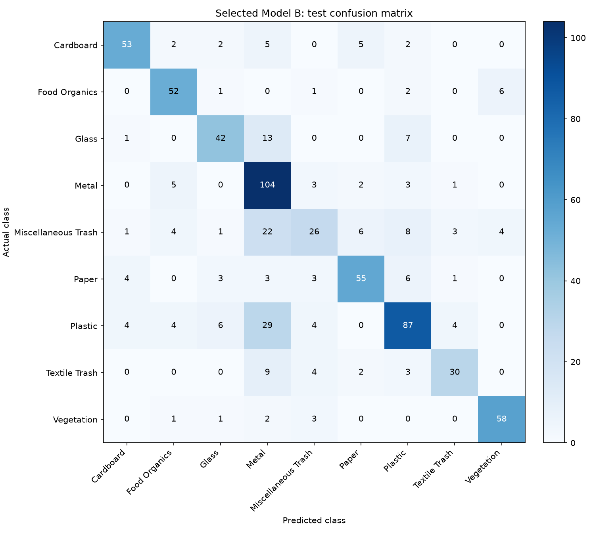

# Model B: controlled horizontal-flip experiment

Horizontal flips reduced best validation accuracy by 0.42 percentage points in this paired run. **No augmentation** was selected using validation results, then achieved **71.11% test accuracy** (507/713). Keep the no-augmentation configuration as the current Model B choice. Horizontal flips alone did not win this validation comparison.

| Configuration | Best validation accuracy | Best epoch | Validation loss at that epoch | Mean epoch time |
| --- | ---: | ---: | ---: | ---: |
| No augmentation | 69.28% | 26 | 0.8794 | 3.91 s |
| Horizontal flip (p=0.5) | 68.86% | 30 | 0.8947 | 2.92 s |

## What changed

Both trials train the unchanged 9,033-parameter Model B for 30 epochs on the same 3,326 training and 713 validation images. They share seed 42, exactly matching starting weights, and exactly matching sample orders in every epoch. Both use batch size 32, Adam at learning rate 0.001, ordinary cross-entropy, zero weight decay, no label smoothing, no scheduler and no early stopping.

The only training change is an independent 50% chance of horizontally flipping each input when it is loaded in the augmented trial. No rotations or colour jitter are used. Validation and test inputs are deterministic and receive no augmentation.

Both trials load the same verified 64 by 64 normalized tensor cache. A horizontal flip simply reverses pixel positions, so it can be applied after normalization without changing values. Tests using one original image from each of the nine classes verify exact equality with a flip applied after RGB resize and before normalization. Identity, flip direction and cache immutability checks also passed. This avoids repeatedly decoding the original JPEG files during training.

## Selection and test evaluation

Each trial restores the first checkpoint attaining its highest validation accuracy. The higher validation accuracy selects the configuration; lower validation loss at that checkpoint breaks ties. The test set plays no part in that choice. Only the selected configuration is evaluated on the 713 test images, then the same checkpoint is reevaluated for verification.

The selected checkpoint is epoch 26 of **No augmentation**. Its weighted precision is 0.7233, weighted recall 0.7111, weighted F1 0.7058, and macro F1 0.7142. The earlier recorded test accuracy was 71.11%; the selected checkpoint differs by +0.00 percentage points. The unselected configuration has no new test measurement.

The fresh control reproduced the earlier optimizer experiment's entire validation-accuracy history exactly. Its initialization and all 30 sample-order hashes also match.

The saved control checkpoint also has the same SHA-256 as the previously stored optimizer-experiment checkpoint, confirming byte-for-byte reproduction of that artifact.

## Interpretation and limits

This comparison isolates horizontal flipping for one training seed and this fixed split. It does not test rotation, colour jitter, weight decay, label smoothing or the scheduler individually, so it cannot identify the cause of the earlier combined-settings result. It also does not establish a repeatable improvement across seeds. The test split has appeared in earlier assignment experiments; it is not a newly collected independent evaluation set.

Keep the no-augmentation configuration as the current Model B choice. Horizontal flips alone did not win this validation comparison. Use validation results for further configuration choices and preserve each experiment separately.

## Resources, timing and verification

Both models retain 9,033 parameters, 36.69 KiB of tensor storage and 1,059,392 estimated convolution/linear MACs per image. The selected checkpoint file is 45.94 KiB. Checkpoints are saved locally under `checkpoints/` and excluded from Git.

The epoch times above include training and validation on cached tensors, with four CPU threads. Cache preparation, test evaluation, checkpoint verification and plotting are outside the timer. The trials run sequentially, so these single-run timings do not establish a general speed ranking. They are also not directly comparable with the previous 57.05-second epochs that decoded original images and applied several augmentations during each epoch.

A strict reload reproduced the selected model's full state, confusion matrix and all macro/weighted metrics after reevaluating every test image. `verification.json` records those checks and the checkpoint SHA-256. `reloaded_checkpoint_predictions.csv` provides the true and predicted labels, matched to dataset indices, from that reevaluation.

## Reproduce

```powershell
python -u run_augmentation_ablation.py --epochs 30 --threads 4 --device cpu
```

Use the documented Python environment and full RealWaste dataset. Choose another `--output` directory to preserve this recorded run. `ablation_results.json` stores all settings, histories, split indices, initialization/sample-order hashes, source revision and package versions. `source_snapshot.json` preserves the notebook sources used by the runner. Hardware or library differences can change numerical results.






