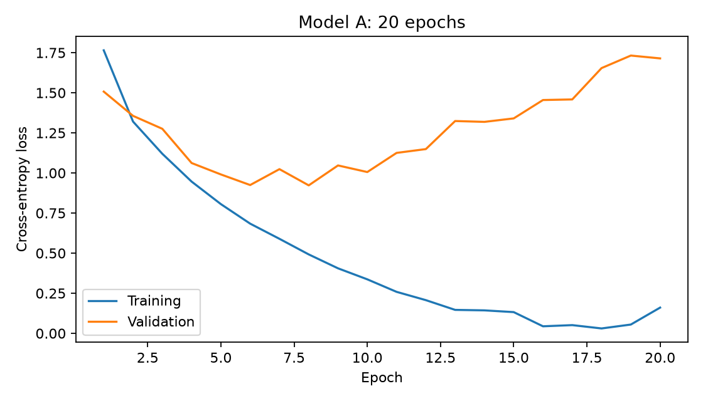
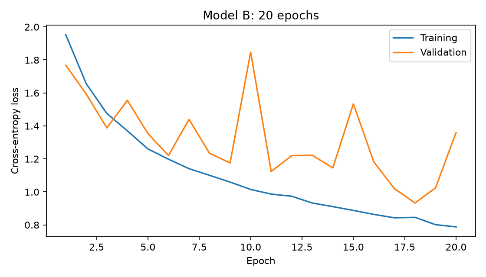
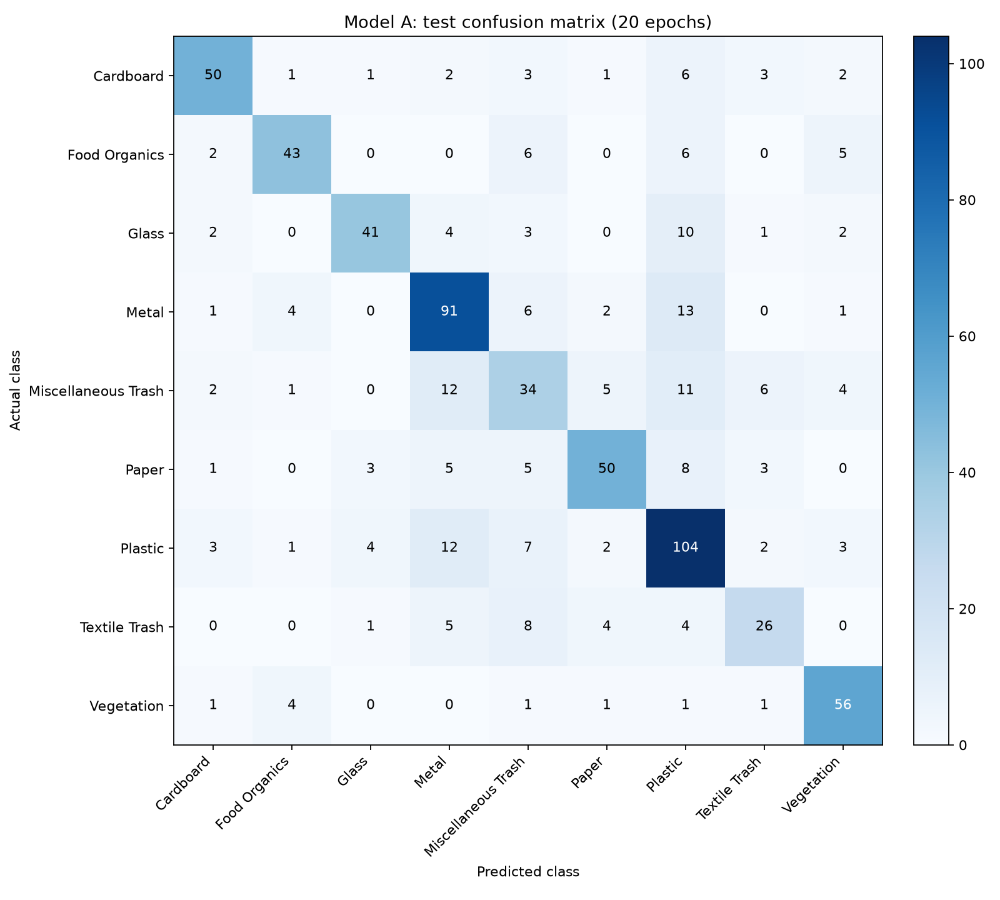
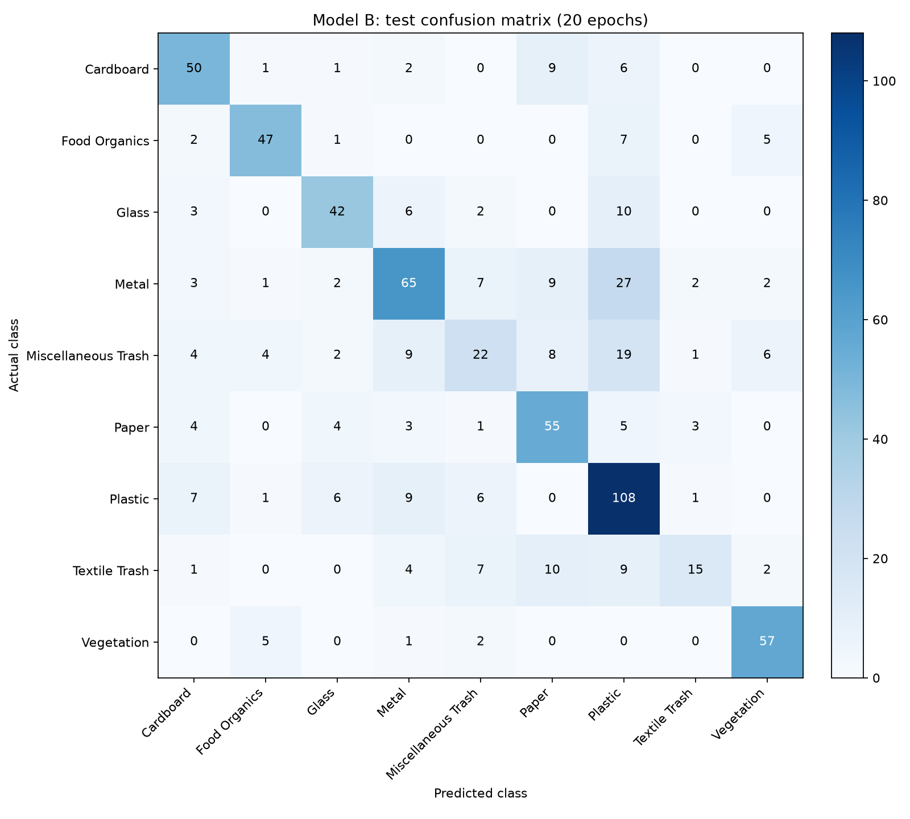

# Custom model training and evaluation

These are the completed local 20-epoch runs, not the later 30-epoch optimizer-selection experiment. Both custom models used Adam with learning rate 0.001, batch size 32, 64 by 64 images, ImageNet normalization, and the same stratified 70/15/15 split. The initialization seed was 42. Images were cached in RAM for CPU training. The highest validation-accuracy checkpoint was restored before evaluation on the 713 test images.

| Model | Trainable parameters | Tensor storage | Saved checkpoint | Mean epoch time | Test accuracy | Weighted precision | Weighted recall | Weighted F1 |
| --- | ---: | ---: | ---: | ---: | ---: | ---: | ---: | ---: |
| Model A | 549,161 | 2,145.16 KiB | 2,149.58 KiB | 11.42 s | 69.42% | 0.6997 | 0.6942 | 0.6935 |
| Model B | 9,033 | 36.69 KiB | 46.62 KiB | 3.88 s | 64.66% | 0.6476 | 0.6466 | 0.6351 |

Tensor storage sums parameter and buffer bytes; the saved checkpoint is measured from the actual trained state-dictionary file and includes serialization overhead. KiB means 1,024 bytes. Neither measurement includes intermediate activations or optimizer state. Epoch time includes both training and validation, with initial image decoding and resizing outside the epoch timer.

Model A has higher test accuracy in this pair of runs, while Model B has a much smaller parameter footprint and lower observed epoch time. The lightweight model combines depthwise separable convolutions, early downsampling, batch normalization, and global average pooling. In particular, removing Model A's large dense layer accounts for much of the parameter saving; the entire difference cannot be assigned to convolution type alone.

Model A's training loss continues to fall while its validation loss rises later in training, indicating overfitting. Model B's validation loss also fluctuates, so selecting checkpoints on validation accuracy is useful. More epochs alone do not guarantee improved generalization. Augmentation or regularization would require a separate controlled experiment.

These are single runs. Although the split, training budget, and optimizer match, the original local runner did not enforce identical sample orders between architectures. They provide an initial resource/accuracy comparison, not a statistical performance ranking. The separate optimizer comparison adds explicit sample-order controls for Model B. CPU timings also depend on machine load and should not be directly compared with Colab GPU timings.

