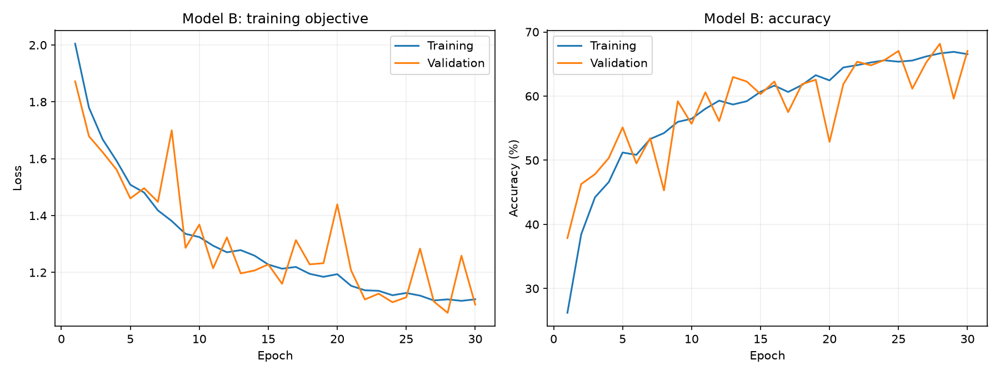
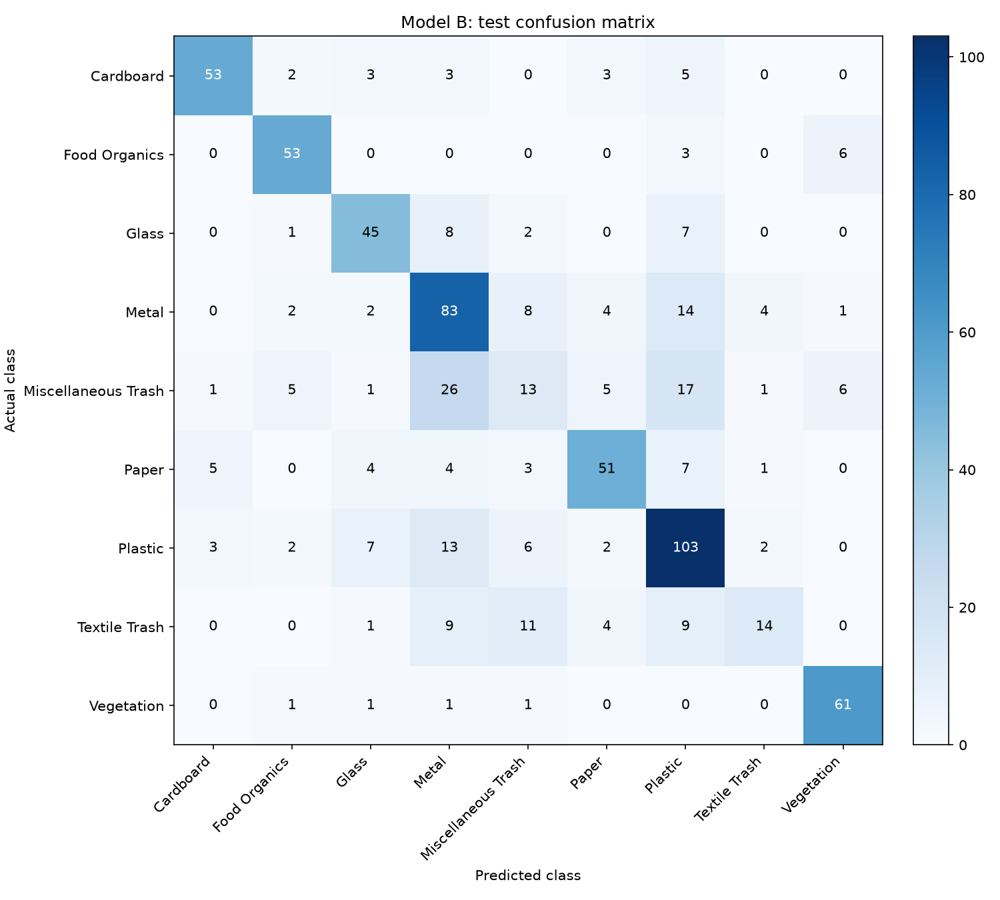

# Model B: 30-epoch RealWaste experiment

The new training settings achieved **66.76% test accuracy** (476/713 images), 4.35 percentage points lower than the earlier result. The best validation checkpoint was epoch 28, with 68.16% validation accuracy. Test evaluation took place after selecting the checkpoint using validation accuracy.

| Measurement | Earlier baseline | New training settings |
| --- | ---: | ---: |
| Best validation accuracy | 69.28% | 68.16% |
| Selected epoch | 26 | 28 |
| Test accuracy | 71.11% | 66.76% |
| Weighted precision | 0.7233 | 0.6558 |
| Weighted recall | 0.7111 | 0.6676 |
| Weighted F1 | 0.7058 | 0.6526 |
| Macro F1 | 0.7142 | 0.6507 |

## Training setup

Both experiments use the same 9,033-parameter Model B architecture, 64 by 64 RGB inputs, ImageNet normalization, batch size 32, Adam learning rate 0.001, 30 training epochs, and seed 42. The 3,326 training, 713 validation and 713 test indices exactly match the recorded baseline. Validation and test images receive deterministic transforms.

This run adds training-only horizontal flips, rotations of up to 10 degrees and mild colour jitter, Adam weight decay 0.0001, label smoothing 0.05, and ReduceLROnPlateau with factor 0.5 and patience 3. All 30 epochs completed. The learning rates actually used were: epoch 1: 0.001, epoch 21: 0.0005.

The final epoch reached 66.54% training accuracy and 67.04% validation accuracy. The test metrics describe the restored best validation checkpoint, rather than necessarily the final epoch's weights.

## Interpretation and limits

Best validation accuracy changed by -1.12 percentage points and test accuracy by -4.35 percentage points relative to the earlier recorded baseline. This is one seed and several training settings changed together. The earlier optimizer experiment also enforced its own recorded sample order. This comparison measures the resulting training configurations; it cannot isolate which individual change caused the difference or establish a general improvement across runs.

Use validation results to choose subsequent settings. Report the final selected configuration's test performance and retain the earlier results as separate experiments.

The earlier baseline remains the stronger Model B choice on validation (69.28% versus 68.16%). The augmented configuration did not improve this 30-epoch run and is retained as an experimental result. The added training controls remain available for subsequent experiments; their availability does not establish an accuracy gain.

## Class-level errors

Recall varies substantially between classes. Vegetation reaches 93.85% (61/65), while Miscellaneous Trash reaches 17.33% (13/75) and Textile Trash reaches 29.17% (14/48). Of the 75 Miscellaneous Trash images, 26 are predicted as Metal and 17 as Plastic. The per-class classification CSV and labelled confusion matrix retain these details alongside the overall accuracy.

## Resources and timing

The model retains 9,033 parameters, 36.69 KiB of tensor storage and 1,059,392 estimated convolution/linear MACs per image. The measured checkpoint file is 45.14 KiB.

The mean training-plus-validation epoch time was 57.05 seconds on Intel(R) Core(TM) i7-8650U CPU @ 1.90GHz, with four PyTorch CPU threads. This run decodes original images from disk and applies augmentation during training. The earlier 3.13-second baseline used normalized tensors cached in RAM. These timings describe different input pipelines and do not establish a model-compute speed difference. Initial dataset discovery, test evaluation, plot generation and checkpoint export are outside the epoch timer.

## Reproduce and inspect

```powershell
python -u run_training.py --models b --epochs 30 --device cpu --threads 4 --output results/model_b_improved_30epochs_seed42
```

Run from the repository using the documented Python environment and full RealWaste dataset. Choose a new output directory to preserve this recorded run. Hardware and library differences may change numerical results.

`experiment.json` contains settings, split indices, complete histories and metrics. `provenance.json` records source revision, file hashes, package versions and CPU details; `source_snapshot.json` preserves the notebook sources used for this run. The trained state dictionary is saved locally as `checkpoints/model_b.pt` and excluded from Git.

An independent strict reload of that checkpoint and reevaluation of all 713 test images reproduced the full confusion matrix, accuracy, and macro/weighted metrics. Parameter count, storage measurements, 30 epoch records and checkpoint-selection bookkeeping also passed verification. `validation.json` records the checks and the checkpoint SHA-256 hash.




