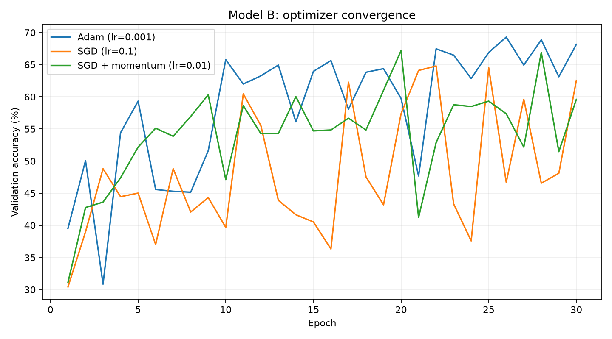
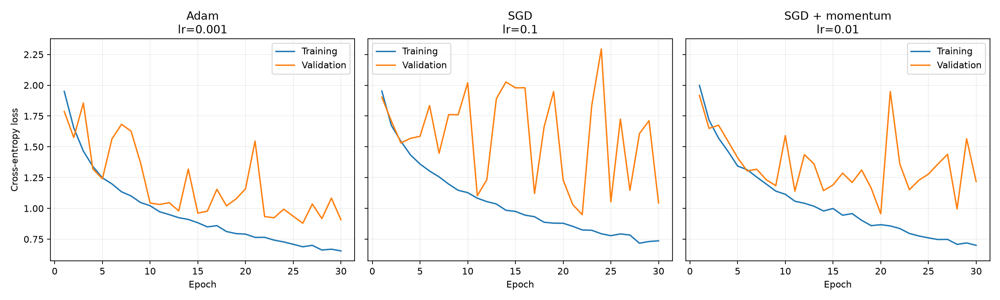
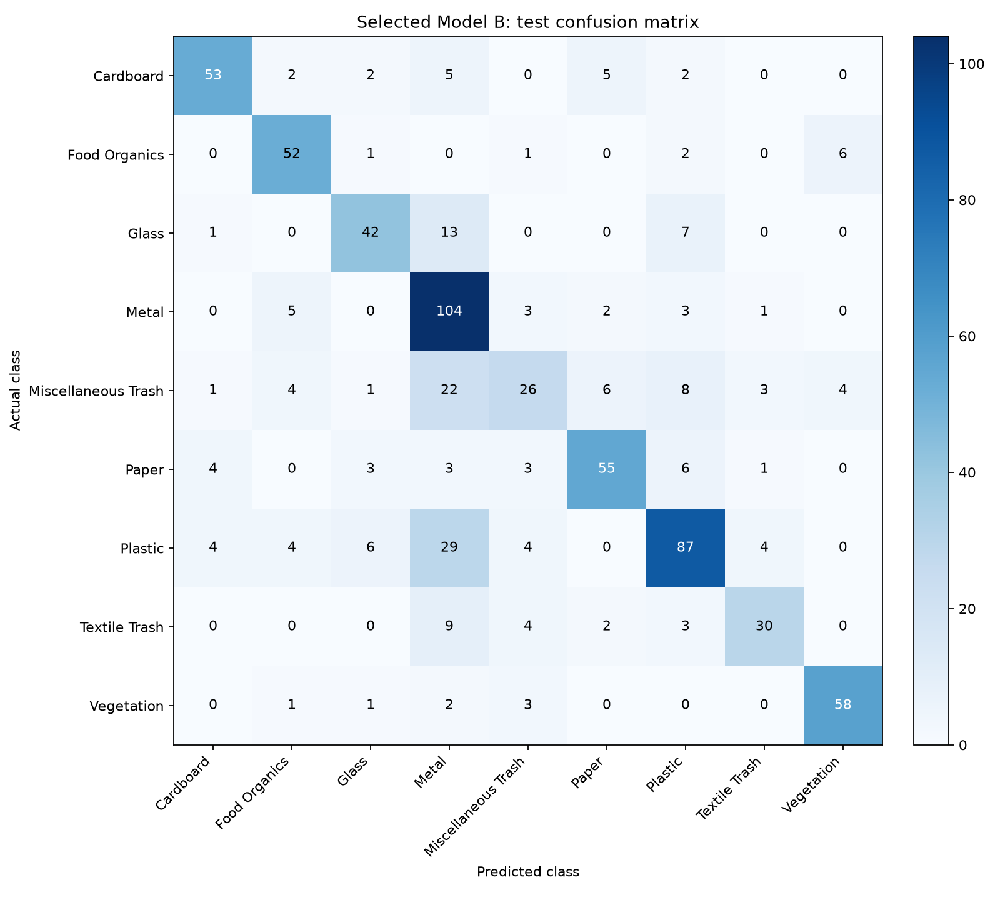

# Model B: optimizer selection and tuning

This experiment completes the comparison between Adam, ordinary SGD, and SGD with momentum. Model B's architecture, 64 by 64 input resolution, normalization, batch size of 32, initial weights, and sample order were held constant. Each optimizer received two learning-rate candidates and 30 epochs per candidate. No augmentation, scheduler, or weight decay was added.

RealWaste was split into 3,326 training, 713 validation, and 713 test images using the notebook's stratified split and split seed 42. The initialization and sampling seed was 42. State hashes and the 30 per-epoch sample-order hashes match across all six trials. The local CPU runner cached the same normalized image tensors in RAM, and reported times include both training and validation.

Each trial restored the first checkpoint achieving its highest validation accuracy. Optimizer and learning-rate selection used validation accuracy, with validation loss at that checkpoint breaking ties. The test set was used only after selecting the final configuration in this experiment.

| Optimizer | Learning rate | Momentum | Best validation accuracy | Best epoch | Validation loss at that epoch | Mean epoch time |
| --- | ---: | ---: | ---: | ---: | ---: | ---: |
| Adam | 0.001 | - | 69.28% | 26 | 0.8794 | 3.13 s |
| Adam | 0.0003 | - | 64.52% | 30 | 0.9993 | 4.47 s |
| SGD | 0.01 | 0 | 54.84% | 25 | 1.3524 | 7.53 s |
| SGD | 0.1 | 0 | 64.80% | 22 | 0.9488 | 6.23 s |
| SGD + momentum | 0.01 | 0.9 | 67.18% | 20 | 0.9560 | 4.50 s |
| SGD + momentum | 0.1 | 0.9 | 67.04% | 27 | 1.0241 | 4.37 s |

The selected configuration was **Adam with learning rate 0.001**. It achieved 69.28% validation accuracy at epoch 26. Its held-out test accuracy was **71.11%**, with weighted precision 0.7233, weighted recall 0.7111, and weighted F1 0.7058. Macro F1 was 0.7142; it gives each class equal weight, while weighted F1 accounts for the different class frequencies.

Model B retained 9,033 trainable parameters. Its parameters and buffers occupy 36.69 KiB as tensors. The saved PyTorch state-dictionary file occupies 45.94 KiB including serialization overhead. These are different measurements; neither includes intermediate activations or optimizer state during training.

## Effect of momentum

For ordinary SGD, a parameter update uses the current batch's gradient. With momentum 0.9, the update buffer retains 90% of its previous value before adding the current gradient. Consistent directions can accumulate across batches, which can improve progress through flat regions; accumulated updates can also overshoot. The momentum coefficient controls how long previous gradients influence subsequent updates.

At learning rate 0.01, adding momentum increased best validation accuracy by 12.34 percentage points (54.84% to 67.18%). The best checkpoint occurred at epoch 25 for ordinary SGD and epoch 20 for momentum SGD.

At learning rate 0.1, adding momentum increased best validation accuracy by 2.24 percentage points (64.80% to 67.04%). The best checkpoint occurred at epoch 22 for ordinary SGD and epoch 27 for momentum SGD.

The validation-accuracy and loss plots show the full convergence paths. Best-checkpoint epochs describe when the observed maximum occurred; they do not by themselves prove that an optimizer always converges faster. Momentum adds one parameter-sized buffer during training, while ordinary SGD needs no momentum buffer. Adam maintains first- and second-moment estimates. These optimizer states affect training memory but are not part of the exported inference model.

## Learning-rate choice and limitations

Adam's two learning rates test a smaller adaptive-update scale. SGD uses 0.01 and 0.1, and momentum SGD uses exactly the same two rates, allowing the effect of momentum to be compared at a fixed learning rate. The final rate is selected from the validation results rather than from test accuracy. A single common learning rate would not necessarily suit all three optimizers.

This is a one-seed comparison on a small predefined grid, with the same 30-epoch budget for every trial. It does not estimate variability across seeds, and it does not establish that one optimizer is universally best. CPU epoch times depend on hardware, machine load, temperature, and the cached input pipeline. Trials ran sequentially without repeated timing runs or a randomized execution order, so these timings do not establish an optimizer speed ranking and should not be directly compared with the earlier Colab T4 results. The earlier 20-epoch local run also had different batch-order controls, so its accuracy difference cannot be attributed solely to the extra epochs or the optimizer.

The original saved notebook reports 66.34% test accuracy for Model B. The new run uses explicit initialization and sample-order controls, so that historical value is context rather than a controlled baseline. The Adam and SGD validation rows above provide comparisons under the same experiment protocol.

References: [PyTorch SGD](https://docs.pytorch.org/docs/2.14/generated/torch.optim.SGD.html), [PyTorch reproducibility](https://docs.pytorch.org/docs/2.14/notes/randomness.html).
